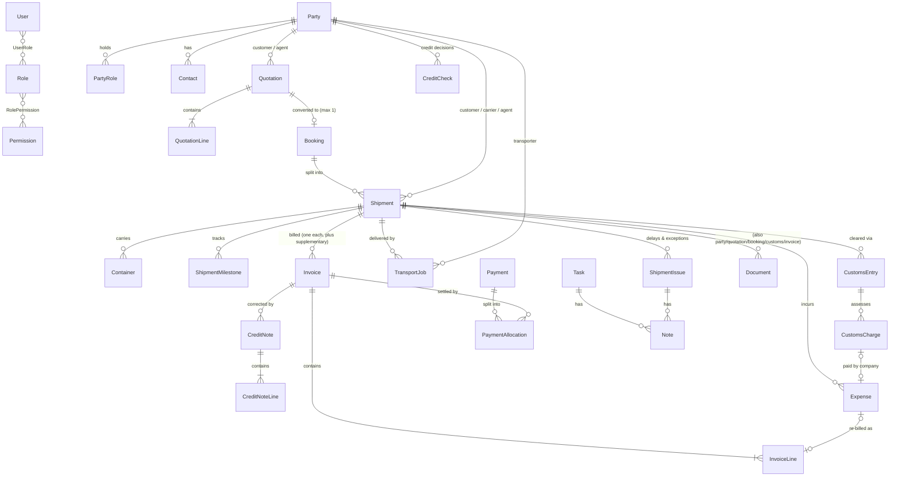

# Database design — freight management

Status: **implemented** in `Backend/backend/src/prisma/contract.prisma` and the migration `Backend/backend/migrations/app/20261026T1926_freight_core_schema/` (branch `feature/database-schema`). Approved by the repository owner on 2026-10-26. Applied to the repository owner's local database only. The backend has **no API endpoints** for these tables yet, and reference data (roles, permissions, retention periods, charge types) is **not seeded** yet.

The activity log in the root `CLAUDE.md` (LOG-20261026-2215-database-schema) records how this was built and checked.

## 1. Business rules this design implements (repository owner, 2026-10-26)

| Topic | Rule |
|---|---|
| Currency | KES only. No currency or exchange-rate columns. |
| Tax | VAT-registered; invoices go through KRA eTIMS. Issued invoices are locked; corrections are credit notes. The eTIMS connection itself is not built (fields only). |
| Disbursements | The company pays duties and port charges on customers' behalf and re-bills them (at cost or with a margin). |
| Clearing-only jobs | A shipment can exist without a quotation or booking. |
| Quotation → booking | A quotation leads to at most one booking. Quotations are edited in place while `draft` or `sent`, and locked once accepted. Earlier values are kept in the audit log. |
| Booking → shipments | One booking can become several shipments. Container and seal numbers are tracked. |
| Invoicing | One invoice per shipment (no consolidated invoices). Supplementary invoices and credit notes are allowed. |
| Agents | External/partner agents are used. |
| Transport | The company owns no trucks; road transport is subcontracted (TransportJob per truck). |
| Payments | Cheque and bank transfer only (no M-Pesa). Customers may have credit terms and a credit limit. Bounced cheques stop counting toward balances. |
| Credit limit | Staff get a warning and choose to proceed or block. Only **finance, management and admin** may proceed past the limit; sales and operations see the warning only. Every decision records the user, time and reason (`CreditCheck`). The permission must be enforced by the backend, not only the UI. |
| Access | Permissions are data (`Permission`, `RolePermission`), so they can change without code changes. Starting matrix: §6. |
| Retention | 5 years from the end of the reporting period, longer where an amended assessment or ongoing proceedings require it (legal hold). Stored in `RetentionPolicy`, so the period can be changed later. Nothing is deleted automatically. |
| References | `PREFIX-YYYY-NNNNN`, restarting each year (e.g. `SHP-2026-00042`), from `NumberSequence`. |

## 2. Conventions

| Topic | Convention |
|---|---|
| Keys | `Int` autoincrement primary keys (matches the existing `User`). URLs and documents use business references. |
| Money | `Numeric(14, 2)` (`Money` alias). Values arrive in code as exact strings such as `"1250.00"`. Sum money in SQL; never use JavaScript floating point for totals or balances. |
| Quantities / rates | `Numeric(12, 3)` (`Quantity`), `Numeric(5, 2)` (`Percent`). |
| Instants | `TimestamptzJsDate(3)` (`Instant` alias) → PostgreSQL `timestamptz(3)`, JavaScript `Date` in code. Used for events, deadlines and tracking (ETD/ETA, milestones, receipts, task due times, audit). Stored as exact moments; shown in Africa/Nairobi time (UTC+3, no daylight saving). |
| Calendar dates | `DateString` (`CalDate` alias) → PostgreSQL `date`, `"YYYY-MM-DD"` string in code. Used for quotation validity, invoice issue/due dates, cheque dates, expense dates, document expiry. Read on the Nairobi business calendar ("overdue" = due date before today in Nairobi). |
| Why not `DateTime` / `Date` | In this Prisma version they map to `Temporal`, which Node 24 does not have. The chosen types need **no new dependency**. Moving to `Temporal` later (Node 26.8.2+) changes code types only, not columns. |
| Exception | `User.createdAt` stays `timestamptz` (6 digits) so the migration did not rewrite an existing column; it still reads as a `Date`. |
| Statuses | PSL `enum`s stored as `text` with a generated CHECK. Allowed transitions are enforced in NestJS services. |
| Integrity rules | 88 CHECK constraints (enum values plus hand-written rules such as "issued invoice has totals", "cheque has number and bank", "delay has reason and original date"). |
| Deletion | `onDelete` defaults to `Restrict`. Only owned child rows cascade (lines, contacts, role links, milestones, notes). Business records are cancelled, archived or put on legal hold, never hard-deleted. |
| Derived values | Not stored, except invoice and credit-note totals, which are frozen at issue (legal documents). Balances, "part paid", "overdue", "booked", the current ETA and milestone done/current/pending are calculated. |
| Timestamps | `createdAt` / `updatedAt` on business tables. `updatedAt` is set by application code (Prisma 8 has no hooks). |
| Files | Documents store metadata and a private `storageKey` only; file contents go to private object storage (not built). |

## 3. Tables (33)

| Area | Table | Purpose |
|---|---|---|
| Access | `User` | Staff (and later portal) accounts. `partyId` links a future portal user to a customer/agent. |
| | `Role`, `UserRole` | Roles and user–role links (many-to-many). |
| | `Permission`, `RolePermission` | Permission codes (e.g. `credit.override`) and role–permission links. |
| | `AuditLog` | Append-only change history (`changes` is `jsonb`). |
| | `RetentionPolicy` | Retention period per record category. |
| Parties | `Party` | Customers, agents, suppliers, carriers, transporters. KRA PIN (unique when set), payment terms, credit limit, account status. |
| | `PartyRole` | The roles a party holds (one company can be several). |
| | `Contact` | People at a party. |
| Shared | `ChargeType` | Catalogue of charges and costs (category, default tax, disbursement flag). |
| | `NumberSequence` | Gap-free reference numbers per prefix and year. |
| Sales | `Quotation`, `QuotationLine` | Quotations and their priced lines. |
| | `Booking` | Confirmed arrangement; optional unique link to one quotation. |
| Operations | `Shipment` | Cargo movement; optional booking; planned and actual dates. |
| | `Container` | Containers and seals per shipment (number format checked: 4 letters + 7 digits). |
| | `ShipmentMilestone` | Planned checkpoints and actual tracking times. |
| | `ShipmentIssue` | Delays and other exceptions: reason, revised date, follow-up, customer notification, resolution. |
| | `TransportJob` | Each hired truck / delivery leg. |
| | `Task` | Follow-up tasks linked to shipments, quotations, documents or invoices. |
| | `Note` | Manual or automatic notes on a task or an issue (exactly one parent). |
| Documents | `Document` | Document metadata, review status, paper-original tracking, legal hold. Linked to at least one of party, quotation, booking, shipment, customs entry, invoice. |
| Customs | `CustomsEntry` | Declaration per shipment (official number unique when set), regime, status, release. |
| | `CustomsCharge` | Assessed duties and fees, who paid them. |
| Finance | `Invoice`, `InvoiceLine` | Invoices (one shipment each), lines with VAT category/rate and disbursement flag, eTIMS fields. |
| | `CreditNote`, `CreditNoteLine` | Corrections to issued invoices. |
| | `Payment` | Cheques and bank transfers, with clearing/bounce status and reconciliation. |
| | `PaymentAllocation` | Splits a payment across invoices (partial payments). |
| | `Expense` | Supplier costs per shipment / truck / customs charge; approval; optional link to the invoice line that re-bills it. |
| | `CreditCheck` | Every credit-limit decision (proceed/blocked) with user, time and reason. |

The full column list is in `contract.prisma`; the generated SQL is in the migration package (`prisma migration show 20261026T1926_freight_core_schema`).

## 4. Relationships



**Workflow:** a quotation moves `draft → sent → accepted` (or `declined`/`expired`). An accepted quotation becomes a booking, whose route and cargo are copied as a snapshot. A confirmed booking produces one or more shipments. Clearing-only shipments have no booking. Delays are detected from planned vs actual milestone times and recorded as `ShipmentIssue` rows of type `delay`. The revised date never overwrites the planned ETA. Customs charges paid by the company become expenses, re-billed through invoice lines marked as disbursements.

**Balances:** invoice balance = frozen total − allocations from non-bounced, non-cancelled payments − issued credit notes. Unallocated customer credit = payment amount − allocations. The services must enforce, under a row lock, that allocations never exceed the payment amount or the invoice balance. A CHECK constraint cannot sum across rows.

## 5. Not built yet (deliberately deferred)

- Reference-data seeding: roles, the permission matrix (§6), the retention policy (5 years) and charge types. Prisma 8 has no seed command; plan a script or a data migration with the auth module.
- Backend enforcement: an auth module, a permission guard (including `credit.override`), number generation, allocation/credit-limit services, audit logging.
- Deferred tables: quotation revisions, document versions, cost estimates (the frontend's `CostEstimate`), agent routes (`AgentRoute`), portals, notifications, warehouse, eTIMS integration logs.

## 6. Starting permission matrix (adjustable data, not code)

| Role | Invoices | Customs assessments | Payments and financial records |
|---|---|---|---|
| Administrator | Manage, subject to authorization | Manage, subject to authorization | Manage, subject to authorization |
| Finance | View and manage | View relevant assessments and charges | View and manage |
| Operations | View relevant documents as needed | View and manage operational clearance documents | Limited access to relevant charges |
| Sales | View quotations and relevant customer billing information | Only if required for their work | No general access |
| Management | View reports and financial records | View as needed | View reports and approve transactions |
| Customer (portal, later) | Only their own authorized documents | Only assessments relating to their shipments, where appropriate | Only their own invoices and payment information |

Credit-limit override (`credit.override`): finance, management, admin.

## 7. Differences from the current frontend demo types (`Frontend/frontend/lib/types.ts`)

The frontend has not been changed. The API layer will need to map these, or the frontend will need updating:

- `Currency = 'KES' | 'USD'`: the database is KES only.
- `PaymentMethod` includes `mpesa`: the database allows `cheque` and `bank_transfer` only.
- `QuotationStatus` stores `booked`: the database derives it from the existing `Booking`.
- `StaffRole` has `documentation` and no `sales`: roles are data rows, so both can exist.
- Quotation line prices are integer cents in the frontend; the database uses exact decimals.
- `Shipment.customs` is a single entry; the database allows several customs entries per shipment.
- `InvoiceStatus` `part_paid` / `paid` / `overdue` are derived in the database design.

## 8. Setting up or updating a local database

Use Node 24.20.0 (root `.nvmrc`; both `package.json` files have `"engines": { "node": "^24.20.0" }`). Run the commands from `Backend/backend`, with `DATABASE_URL` in your own `.env` pointing at **your own** local PostgreSQL.

```bash
npm ci                                  # exact lockfile versions
npx prisma db verify                    # read-only: does the DB match the contract? (exit 0 = yes)
npx prisma db migrate --show            # read-only: which migrations would run
npx prisma db migrate --advance-ref db  # apply pending migrations (one transaction)
npx prisma db verify                    # confirm
```

A fresh, empty database runs both packages: `20261026T1925_baseline` (the original `User` table) and `20261026T1926_freight_core_schema` (everything else). A database already at the original `User` contract runs only the second. A database created some other way, for example with `db update`, may report a marker mismatch. Check `db verify` before applying anything, and never reset a database you have not confirmed is disposable.

**Changing the schema later:** edit `contract.prisma` → `npx prisma contract emit` → `npx prisma migration plan --name <snake_case_name>` → review it with `npx prisma migration show <dir>` and `npx prisma migration check` → `npx prisma db migrate --advance-ref db` → commit the contract, the generated `contract.json`/`contract.d.ts`, the new migration folders, the new snapshot and `migrations/app/refs/db.json` together. Never edit `contract.json`, `contract.d.ts`, `ops.json` or `migration.json` by hand. If `migration.ts` must be edited (for example to fill a `placeholder`), re-emit it with `node migrations/app/<dir>/migration.ts`. `db update` is only for throwaway experiments because it leaves no migration history.

## 9. Inspecting the tables

- **pgAdmin:** connect to your local server → your database → Schemas → `public` → Tables (33). Each table's Constraints node shows primary keys, foreign keys, unique and check constraints. Right-click the database → **ERD For Database** for a diagram. The `prisma_contract` schema holds Prisma's migration marker; do not edit it.
- **psql:** `\dt public.*` (tables), `\d+ "Invoice"` (columns, constraints, indexes). Table names are case-sensitive and need double quotes.
- **Prisma:** `npx prisma db schema` prints the live schema (read-only).
